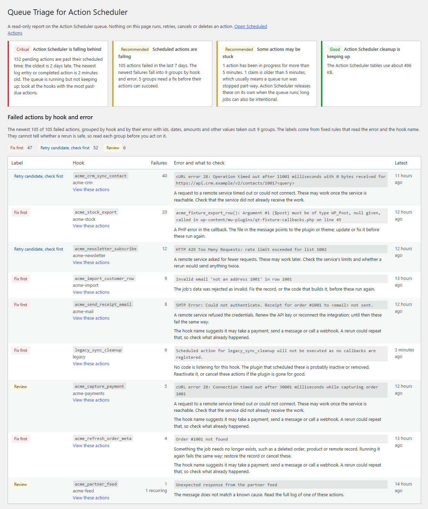

# Queue Triage for Action Scheduler

A free WordPress plugin that explains why [Action Scheduler](https://actionscheduler.org) jobs fail or stall. Action Scheduler is the background job queue inside WooCommerce and many other plugins.

It adds one read-only screen under **Tools > Queue Triage**, two Site Health tests, a Site Health Info section and a WP-CLI command. It never runs, retries, cancels, edits or deletes an action, never writes to the database, stores nothing and makes no external requests.



## What it shows

- **Failure groups.** The newest failed actions (500 by default) grouped by hook and by their error. Ids, dates, amounts, quoted values, hashes and numbers are replaced with placeholders, so failures that differ only in an order number share a group. Error codes and HTTP status codes stay, because they tell causes apart.
- **A label for each group**, from fixed rules:
  - *Fix first*: no callback registered, PHP errors, memory or time limits, rejected credentials, deleted records, invalid data, failed queries.
  - *Retry candidate, check first*: timeouts, connection errors, rate limits, remote server errors, database deadlocks.
  - *Review*: everything else, Action Scheduler's own timeout (the callback may have done part of its work), and any retry candidate whose hook name suggests payments, renewals, refunds, receipts, emails, orders, subscriptions or webhooks.
- **Past-due actions**: the count, how late the oldest is, and the ten hooks with the most.
- **The runner**: whether `DISABLE_WP_CRON` is set, when `action_scheduler_run_queue` is due, when anything last ran, and the batch size, concurrency and time limit in effect.
- **Stuck work**: actions in progress for more than five minutes and claims older than five minutes.
- **Storage**: rows and size of the four Action Scheduler tables, the retention periods in effect (they changed in Action Scheduler 4.0.0), and whether cleanup keeps up.
- **Environment**: the Action Scheduler version in use, the plugin it comes from, and every bundled copy.
- **A support report**: plain text with counts, settings, hook names and error signatures. Action arguments, action ids, group names, email addresses, IP addresses, URL queries and server paths are left out.

## Why the labels never say "safe"

The rules see the error text and the hook name only. A timeout does not prove a payment did not go through, and a rate limit does not prove a webhook was not delivered. The best a group gets is "retry candidate, check first". Action Scheduler does not run a failed action again either: running the work again means scheduling a new action with the same hook and arguments, which is a decision for whoever knows the callback.

This plugin is the in-dashboard companion to [action-scheduler-triage](https://github.com/hamzaahmadaslam/action-scheduler-triage), a command-line tool by the same author that reads a WP-CLI export of failed actions.

## Requirements

- WordPress 6.5 or later, PHP 7.4 or later.
- Action Scheduler 3.9.2 or later with its own database tables (the default since 3.0). Without it the screen says so, and if its tables remain after the plugins that used it are gone, it still reads them.

## WP-CLI

```sh
wp queue-triage report                  # the support report
wp queue-triage report --format=groups  # failure groups as a table
wp queue-triage report --format=json --sample=2000
```

## Filters

- `queue_triage_capability`: who can see the screen (default `manage_options`).
- `queue_triage_failed_sample`: how many failed actions to read (default 500, at most 5000).

## Development

```sh
composer install
vendor/bin/phpcs          # WordPress Coding Standards 3 and PHP 7.4 compatibility
vendor/bin/phpunit        # unit tests for parsing, grouping, labels and checks
WP_PATH=/path/to/test-wordpress bash tests/integration.sh
bash bin/build.sh         # build/queue-triage-for-action-scheduler.zip, as shipped
```

The integration test needs a WordPress install used only for testing, with WooCommerce or the Action Scheduler plugin active. It adds a must-use plugin with failing callbacks, schedules a backlog, runs it with Action Scheduler's own runner, and checks the report, the screen, the Site Health tests, that nothing in the tables changed, and the case where Action Scheduler is not loaded. CI runs it on PHP 7.4 with WordPress 6.5 and Action Scheduler 3.9.2, and on PHP 8.4 with WordPress 7.1 and WooCommerce, then runs the official Plugin Check on the built plugin.

## License

GPL-2.0-or-later. By [Hamza Ahmad Aslam](https://hamzaahmadaslam.com).
